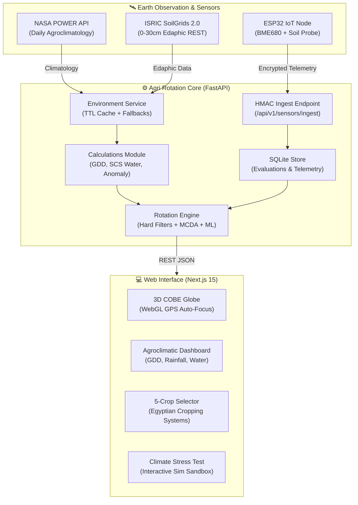

# 🌱 AgriRotation

[](ci/github-actions-ci.yml)
[](backend/tests/)
[](backend/)
[](frontend/)
[](backend/)
[](LICENSE)
[%20%7C%20English-amber.svg)](frontend/app/i18n.ts)

> **Intelligent, Climate-Resilient Agricultural Decision Support & Multi-Year Crop Rotation Platform**  
> *Powered by Earth Observation Satellites (NASA POWER & ISRIC SoilGrids), In-Situ IoT Field Telemetry (ESP32 + BME680), and Hybrid MCDA Rule Engines.*

---

## 📖 Executive Summary

**AgriRotation** is an enterprise-grade agronomic decision-support platform engineered to help farmers, agricultural extension officers, and agronomists design resilient, profitable, and ecologically balanced **3-year crop rotation sequences**. 

Traditional crop management often overlooks compound climate stress (extreme heat days, unseasonal drought, shifting rainfall) and soil depletion (loss of soil organic matter, pest host carry-over). **Agri Rotation** resolves this challenge by cross-referencing **real-time satellite climatology**, **global soil databases**, and **physical on-field microclimate sensors** against deterministic agronomic rules and machine learning likelihood scoring.

```
       [ NASA POWER ]          [ ISRIC SoilGrids ]        [ ESP32 IoT Node ]
     (Agroclimatology)         (0-30cm Edaphic)         (Ground-Truth Sensor)
             │                         │                         │
             └────────────────► [ Agri Rotation ] ◄──────────────┘
                                  Core Engine
                                       │
                  ┌────────────────────┴────────────────────┐
                  ▼                                         ▼
       [ Deterministic Rules ]                   [ Machine Learning ]
       • GDD & Thermal Limits                    • Gaussian Likelihood
       • Water Balance (USDA SCS)                • Historical Probability
       • Botanical Family Breaks                 • In-Situ Calibration
                  │                                         │
                  └────────────────────┬────────────────────┘
                                       ▼
                         [ Ranked 3-Year Rotations ]
                       With Evidence Trail & Provenance
```

---

## 🌟 Core Innovations & Features

### 1. 🛰️ Satellite Earth Observation Integration
* **NASA POWER API (Daily Agroclimatology):** Automatically ingests multi-year historical climate records, calculating seasonal Growing Degree Days (GDD), precipitation anomalies ($\Delta\%$), and critical heat-stress days ($T_{max} > 35^\circ\text{C}$).
* **ISRIC SoilGrids 2.0:** Queries physical soil layers (0–30 cm depth) worldwide, estimating sand/silt/clay fractions, soil pH ($H_2O$), and Soil Organic Matter (SOM) converted via the standard **Van Bemmelen Factor** ($\text{SOM} = \text{SOC} \times 1.724$).
* **USDA SCS Effective Precipitation Model:** Models surface runoff and deep percolation to calculate usable crop water:
  $$\text{Effective Rain} = \begin{cases} P \times 0.8 & \text{if } P \le 250\text{ mm} \\ 125 + (P \times 0.5) & \text{if } P > 250\text{ mm} \end{cases}$$

### 2. 📡 In-Situ IoT Ground-Truth Station (ESP32)
* **Bosch BME680 Sensor:** Captures field temperature, barometric pressure, relative humidity, and VOC air resistance.
* **Capacitive Soil Moisture Probe (v1.2):** Analog root-zone moisture measurement with hardware ADC two-point calibration.
* **Cryptographic Security:** Telemetry payloads are authenticated at the edge via **HMAC-SHA256** device keys and rate-limited at the API gateway.
* **Ground-Truth Calibration Toggle:** Live sensor readings seamlessly calibrate or override coarse satellite estimations in real time with a single click.

### 3. 🧠 Hybrid Decision Engine (Rules + ML)
* **Deterministic Agronomic Filters:** Hard physiological rules screen out unviable crops before scoring:
  * **Thermal Limits:** Base GDD satisfaction and maximum heat tolerance thresholds.
  * **Edaphic Safety:** Minimum and maximum soil pH limits ($pH \in [5.5, 8.5]$).
  * **Critical Water Sufficiency:** Rainfed vs. irrigated water balance thresholds.
  * **Botanical Family Breaks:** Strict multi-year breaks (Fabaceae, Poaceae, Solanaceae, Brassicaceae) preventing pest and pathogen buildup.
* **Multi-Criteria Decision Analysis (MCDA):** Normalizes composite scores ($0\text{--}100$) weighted according to farmer priorities:
  * 💰 **Maximize Profit:** Prioritizes high-market-value crops and reduced fertilizer inputs.
  * 🌿 **Preserve Soil Health:** Maximizes atmospheric nitrogen fixation (legumes) and organic residues.
  * 💧 **Save Water:** Selects drought-resistant crops with high water-use efficiency.
* **Gaussian Likelihood Crop Scorer:** Generates calibrated probability distributions for each crop given environmental parameters.

### 4. 🇪🇬 Egyptian Agricultural Hubs & 5-Crop Strategy
* Built-in calibrated profiles for Egyptian farming hubs:
  1. **الأقصر / وادي النيل (Luxor / Nile Valley)** — Alluvial irrigated soils, high thermal radiation.
  2. **كفر الشيخ / الدلتا (Kafr El-Sheikh / Nile Delta)** — Clay-loam soils, Mediterranean coastal climate.
  3. **توشكى / أسوان (Toshka / Aswan)** — Sandy-loam reclaimed desert, high heat & GDD demand.
* **5-Crop Selection Matrix:** Farmers pick 5 candidate crops (e.g., Wheat, Berseem Clover, Fava Bean, Maize, Potato) and the engine extracts the top viable 3-year sequences while providing smart legume-injection recommendations.

### 5. ⚡ Dynamic Climate Stress-Testing
* Real-time **"What If" simulation sandbox**:
  * Adjust rainfall shift ($-40\%$ to $+20\%$).
  * Adjust temperature increase ($0^\circ\text{C}$ to $+4^\circ\text{C}$).
  * Toggle supplemental irrigation on or off.
* **Deterministic & Idempotent:** Simulations preserve root baseline context, providing immediate in-card visual feedback and updated metrics without compounding distortion.

### 6. 🎨 Organic UI, 3D WebGL Globe & Bilingual Accessibility
* **COBE WebGL 3D Globe:** Smooth interactive globe rotating automatically to the selected farm GPS coordinates with pulsing location beacons.
* **Nature-Inspired Palette:** Warm Cream (`#F7F5EE`), Deep Forest Green (`#143626`), and Soft Stone (`#E2DFD5`).
* **Bilingual English & Arabic (RTL):** Full right-to-left UI with custom Arabic typography (**Firjar**) and localized agronomic terminology.

---

## 🏛️ System Architecture



---

## 📂 Repository Layout

```
feild/
├── backend/                        # FastAPI Backend Application
│   ├── app/
│   │   ├── core/                   # Deterministic engine & scientific calculations
│   │   │   ├── calculations.py     # GDD, effective water, anomaly formulas, ML scorer
│   │   │   └── engine.py           # Hard agronomic filters, MCDA ranking, 5-crop solver
│   │   ├── data/                   # Agronomic datasets (crops.json, families.json, etc.)
│   │   ├── models/                 # Pydantic schemas and data validation
│   │   ├── services/               # Adapters: NASA POWER, SoilGrids, SQLite sensor store
│   │   └── main.py                 # FastAPI application routes & endpoints
│   ├── tests/                      # Automated test suite (61/61 pytest passing)
│   ├── Dockerfile                  # Production backend container definition
│   └── requirements.txt            # Python dependencies
├── frontend/                       # Next.js 15 Web Application
│   ├── app/                        # App router (Main Page, Hardware Page, i18n, Layout)
│   ├── components/                 # React UI widgets (FarmGlobe3D, ClimateDashboard, etc.)
│   ├── lib/                        # Client-side engine fallback and types
│   ├── public/                     # Static assets, fonts (Firjar), and icons
│   ├── Dockerfile                  # Production frontend container definition
│   └── package.json                # Node dependencies & scripts
├── firmware/                       # ESP32 IoT Edge Telemetry
│   ├── field_shift_esp32/
│   │   ├── field_shift_esp32.ino   # Arduino / C++ source for ESP32 + BME680 + Soil Probe
│   │   ├── Secrets.example.h       # Wi-Fi credentials & device HMAC key template
│   │   └── platformio.ini          # PlatformIO project configuration
│   └── README.md                   # Hardware wiring & sensor calibration guide
├── docs/                           # Architectural, agronomic, and deployment runbooks
├── ci/                             # GitHub Actions CI workflow definition
└── docker-compose.yml              # Single-command full-stack container orchestration
```

---

## 🚀 Quickstart Guide

### Prerequisites
* **Node.js** `>= 20.x` (Recommended: `22.x LTS`)
* **Python** `>= 3.12` (Tested on `3.12` and `3.14`)
* **Git** and Internet access (for NASA POWER & SoilGrids requests)

---

### Step 1: Clone the Repository

```bash
git clone https://github.com/abo3ali21/feild.git
cd feild
```

---

### Step 2: Launch the Backend Service

```bash
cd backend

# Create and activate virtual environment
python3 -m venv .venv
source .venv/bin/activate       # On Windows: .venv\Scripts\activate

# Install dependencies
pip install --upgrade pip
pip install -r requirements.txt

# Run backend API server
uvicorn app.main:app --host 0.0.0.0 --port 8000 --reload
```
* The API server will start at `http://localhost:8000`.
* Interactive OpenAPI documentation is accessible at `http://localhost:8000/docs`.

---

### Step 3: Launch the Frontend Web Application

Open a new terminal session:

```bash
cd frontend

# Install dependencies
npm install

# Start Next.js development server
npm run dev
```
* Open your browser at `http://localhost:3000`.
* The frontend automatically proxies `/api/...` calls to the FastAPI server running on port `8000`.

---

### Step 4: Run with Docker Compose (Alternative)

To build and run both Backend and Frontend in isolated containers:

```bash
docker compose up --build
```
Access the application at `http://localhost:3000`.

---

## 📡 IoT Hardware Node Setup (ESP32)

### Bill of Materials (BOM)
| Component | Function | Interface | Operating Voltage |
|:---|:---|:---|:---|
| **ESP32 DevKit V1** | Microcontroller & Wi-Fi Gateway | Wi-Fi 802.11 b/g/n | 3.3V / 5V |
| **Bosch BME680** | Temperature, Humidity, Barometer, Gas | I2C (`0x76` / `0x77`) | 3.3V |
| **Capacitive Soil Moisture v1.2** | Corrosion-Resistant Root-Zone Moisture | Analog (GPIO 32) | 3.3V |
| **SSD1306 OLED (0.96")** | Local In-Field Telemetry Display | I2C (`0x3C`) | 3.3V |

### Wiring Pinout Table
* **I2C Bus:** `SDA -> GPIO 21` | `SCL -> GPIO 22` | `VCC -> 3.3V` | `GND -> GND`
* **Capacitive Soil Probe:** `AOUT -> GPIO 32` | `VCC -> 3.3V` | `GND -> GND`

### Firmware Flashing
1. Navigate to `firmware/field_shift_esp32/`.
2. Copy `Secrets.example.h` to `Secrets.h` and configure your Wi-Fi SSID, Password, and Device Key:
   ```cpp
   #define WIFI_SSID     "Your_WiFi_Name"
   #define WIFI_PASSWORD "Your_WiFi_Password"
   #define DEVICE_ID     "esp32-field-node-01"
   #define DEVICE_KEY    "your-long-secure-hmac-key"
   #define BACKEND_URL   "http://192.168.1.100:8000/api/v1/sensors/ingest"
   ```
3. Upload using **PlatformIO** (`pio run -t upload`) or **Arduino IDE** (with `ESP32` board definitions and `Adafruit BME680` library).

---

## 🔌 API Reference Highlights

| Method | Endpoint | Description |
|:---|:---|:---|
| `GET` | `/api/v1/health` | Healthcheck & service status verification |
| `GET` | `/api/v1/crops` | Returns complete agronomic dataset of all 18 configured crops |
| `POST` | `/api/v1/farms/evaluate` | Evaluates coordinates, runs NASA/SoilGrids query, and ranks rotations |
| `POST` | `/api/v1/farms/simulate` | Re-evaluates baseline rotation against climate shifts (rain/temp/irrigation) |
| `POST` | `/api/farms/evaluate-five` | Evaluates 5 user-selected crops and outputs the top 3 compatible sequences |
| `POST` | `/api/v1/sensors/ingest` | Authenticated HMAC telemetry ingest from ESP32 edge stations |
| `GET` | `/api/v1/sensors/{farm_id}/latest` | Returns recent in-situ ground-truth sensor telemetry |

---

## 🧪 Testing & Quality Assurance

Agri Rotation maintains comprehensive automated test coverage for scientific correctness and robustness.

### Backend Pytest Suite (61 Tests)
```bash
cd backend
PYTHONPATH=. pytest tests/ -v
```
```
backend/tests/test_api.py ..................... [ 10%]
backend/tests/test_engine.py .................. [ 31%]
backend/tests/test_scenarios.py ............... [ 36%]
backend/tests/test_sensor_engine.py ........... [ 55%]
backend/tests/test_sensors.py ................. [ 88%]
backend/tests/test_services.py ................ [100%]
======================= 61 passed in 6.15s =======================
```

### Frontend Code Quality & Static Export
```bash
cd frontend
npm run lint    # 0 errors, 0 warnings
npm run build   # Production Turbopack build & static prerendering
```

---

## 📚 Scientific & Agronomic Foundations

1. **Growing Degree Days (GDD):**
   $$\text{GDD} = \sum \max\left(0, \min\left(\frac{T_{max} + T_{min}}{2}, T_{cutoff}\right) - T_{base}\right)$$
2. **Precipitation Anomaly ($\Delta P$):**
   $$\Delta P (\%) = \left(\frac{P_{seasonal} - P_{historical}}{P_{historical}}\right) \times 100$$
3. **Botanical Family Rotation Breaks:**
   * **Poaceae (Grass / Cereal):** 1-year break.
   * **Fabaceae (Legume / Nitrogen-Fixing):** 1-year break, positive nitrogen credit ($+30\text{--}60\text{ kg N/ha}$).
   * **Solanaceae (Nightshade):** Strict 2-year break to disrupt *Phytophthora* and nematode life cycles.
   * **Brassicaceae (Crucifer):** 2-year break to avoid clubroot contamination.

---

## 🛡️ Responsible Agricultural Use

> **Disclaimer:** AgriRotation provides **comparative agronomic decision support**, not absolute yield predictions or guaranteed financial returns. Soil micro-variability, subterranean drainage, unpredicted extreme weather events, local pest outbreaks, and cultivar choices can alter field outcomes. Always verify recommendations with certified local agricultural extension advisors, on-site soil laboratory tests, and seed availability before planting.

---

## 📄 License & Credits

* **License:** Licensed under the [MIT License](LICENSE).
* **Core Contributors:** Antigravity / Google DeepMind Team & [MO22BARY](https://github.com/MO22BARY).
* **Data Providers:** [NASA POWER Project](https://power.larc.nasa.gov/), [ISRIC World Soil Information](https://www.isric.org/).
