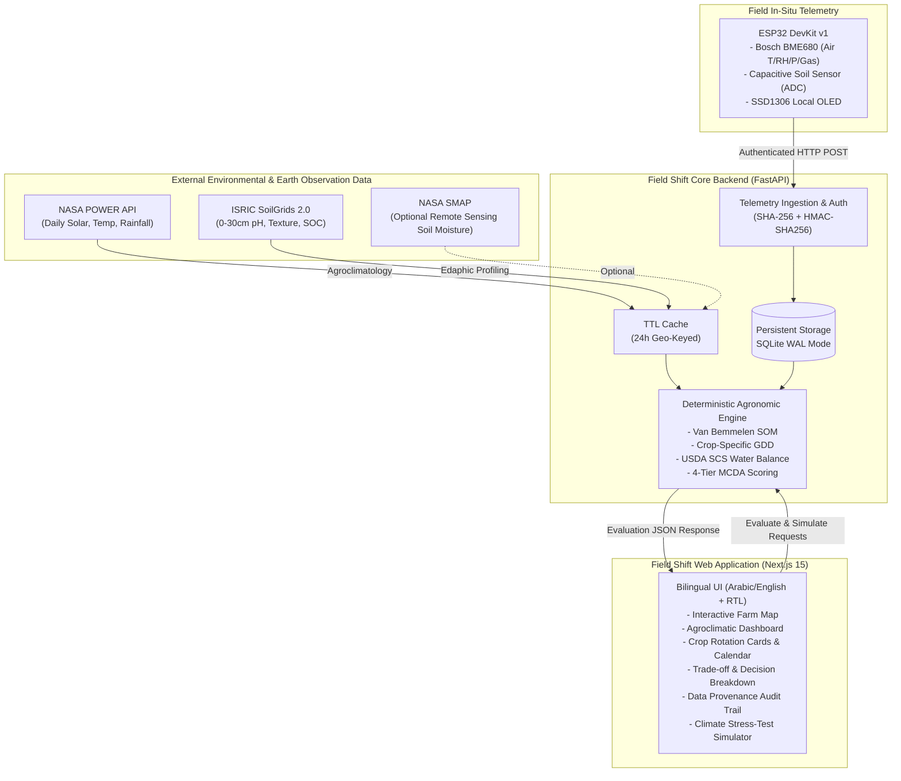
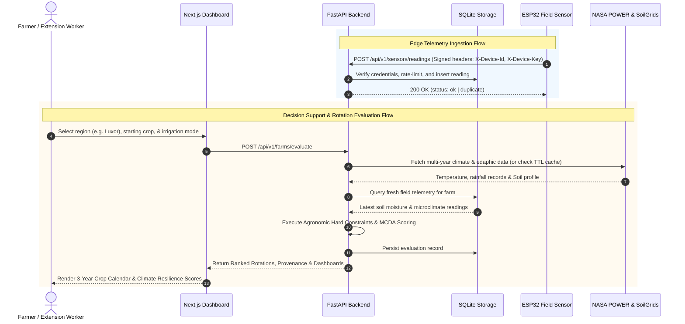

# Field Shift --- System Architecture & Data Flow

This document details the end-to-end architecture and multi-tier data flow of Field Shift v1.0.

---

## 1. High-Level Architecture Diagram

---

## 2. Telemetry & Decision Data Flow

